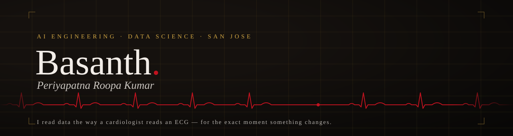

I build machine learning systems and then measure whether they hold up. My current work is
wildfire risk assessment from aerial imagery at **SJSU Research Foundation**, where I am a Graduate
Research Assistant. Before that I was a Research Scientist Intern at **NASA Ames Research Center**
on the FireSage program, following three years of production data and backend engineering in
industry.

Across that work the constant is machine learning applied where a confident wrong answer carries
real cost: wildfire risk, clinical triage, public health forecasting. Model calibration, proper
scoring and reproducible evaluation are part of the build, not a step added at the end.

**[basanthyajman.com](https://basanthyajman.com)** is the full portfolio, case studies, research
write-ups, and the reasoning behind each decision.
[Resume](https://basanthyajman.com/resume) ·
[Career map](https://basanthyajman.com/map) ·
[Root-cause notes](https://basanthyajman.com/writing)

 

## Root-cause notes

The part of the work that interviews actually probe: something broke, here is how I found out why,
and here is the measurement proving the fix held.

| Note | Before | After |
|---|---|---|
| [A wildfire model that was confident and wrong](https://basanthyajman.com/blog/rca-firesense-overconfident-probabilities) | Expected Calibration Error 0.19 | **0.026**, mean IoU unchanged |
| [Why my F1 model gave Hamilton 2.5%](https://basanthyajman.com/blog/rca-f1-hamilton-underrated) | ~2.5% win probability from P3 | **21.2%** [11.8%, 24.1%], finished P3 |
| [Video ingestion before inference](https://basanthyajman.com/blog/cognivi-video-ingestion-system-design) | Intermittent WebM decode failures | Every upload normalised before inference |

 

## Selected work

| | What it is | Evidence |
|---|---|---|
| **Cognivi** | Multimodal stroke screening prototype built at TreeHacks 2026. I designed the service architecture, video ingestion, and the evidence-grounded inference flow. | [Case study](https://basanthyajman.com/case-study/cognivi) · [Devpost](https://devpost.com/software/cognivi-quick-accurate-stroke-detection-under-10) |
| **Professor in a Box** | Graduate capstone. CS tutoring with adapted language models, document retrieval, streaming responses, and provider fallback. | [Write-up](https://basanthyajman.com/publication/personalized-education-agent) · [Code](https://github.com/BasanthPR/DATA-298-Team-2-Personalized-Education-Agent) |
| **FireSense** | Wildfire segmentation from multispectral satellite imagery: channel attention, uncertain boundaries, and calibrated probabilities. | [Write-up](https://basanthyajman.com/publication/firesense-fire-detection) · [Code](https://github.com/BasanthPR/FireSense-Multispectral-Fire-Detection-with-Channel-Attention-and-Probabilistic-Calibration) |
| **F1 Prediction Engine** | A triple-model ensemble (XGBoost, Monte Carlo, Bayesian inference) forecasting the 2026 season. Each race is its own repo, and V2 documents the three V1 failures it corrects. | [Case study](https://basanthyajman.com/case-study/f1-predictor) · [Australia](https://github.com/BasanthPR/2026-australian-gp-prediction) · [China](https://github.com/BasanthPR/2026-chinese-gp-prediction) · [Japan](https://github.com/BasanthPR/2026-japanese-gp-prediction) |

 

## Research

Five research papers authored: four co-authored and complete, the fifth in progress. One is
peer-reviewed with a DOI.

| Paper | Venue | Status |
|---|---|---|
| A Big Data Pipeline Approach for Predicting Real-Time Pandemic Hospitalization Risk | *Algorithms* (MDPI), 2025 | Peer-reviewed · [10.3390/a18120730](https://doi.org/10.3390/a18120730) |
| Professor in a Box: Personalized CS Tutoring via Fine-Tuned Models | SJSU · DATA 298B capstone, 2026 | In progress · [Write-up](https://basanthyajman.com/publication/personalized-education-agent) |
| FireSense: Multispectral Fire Detection with Channel Attention | SJSU · DATA 255, 2025 | [Write-up](https://basanthyajman.com/publication/firesense-fire-detection) |
| A Multimodal Generative AI Framework for Cancer Pathology Classification | SJSU · Applied Data Science, 2025 | [Write-up](https://basanthyajman.com/publication/multimodal-cancer-pathology) |
| Knowledge Graph-Enhanced Traffic Optimization | SJSU · DATA 266, 2025 | [Write-up](https://basanthyajman.com/publication/knowledge-graph-traffic) |

 

## Experience

| | Role | When |
|---|---|---|
| **SJSU Research Foundation** | Graduate Research Assistant, AI & Wildfire Science | Jan 2025 – present |
| **NASA Ames Research Center** | Research Scientist Intern, FireSage Program | Jun 2025 – Aug 2025 |
| **AtkinsRéalis** | Data & Software Engineer | Apr 2023 – Jun 2024 |
| **6D Technologies** | Backend / Data Operations Engineer | Sep 2021 – Sep 2022 |

M.S. Applied Data Science, San Jose State University. Three years of industry engineering and roughly two years of applied research.

 

## What I work with

Grouped by where each was applied in production or research, rather than by what fills out a list.

**LLM and AI systems**, retrieval-augmented generation, fine-tuning adapters, knowledge graphs for
grounding, multi-model benchmarking, vision-language models.
*Used in:* Professor in a Box, Cognivi, the wildfire compliance work.

**Machine learning and statistics**, PyTorch, XGBoost, Monte Carlo simulation, Bayesian inference,
probability calibration, channel attention.
*Used in:* FireSense, the F1 engine, the pandemic risk paper.

**Data and platform**, Python, SQL, Apache Kafka, Apache Spark, PostgreSQL, Azure, AWS, Docker.
*Used in:* the pandemic streaming pipeline, AtkinsRéalis, 6D Technologies.

**Vision and geospatial**, segmentation, object detection, multispectral and UAV imagery,
parcel-level geospatial joins.
*Used in:* FireSense, the NASA Ames FireSage work.

 

## Elsewhere

[Portfolio](https://basanthyajman.com) · [Writing](https://basanthyajman.com/writing) ·
[LinkedIn](https://www.linkedin.com/in/basanth-p-r/) · [Email](mailto:basanthpr11@gmail.com)

The portfolio is the source of truth for everything here. If the two ever disagree, trust the site.
